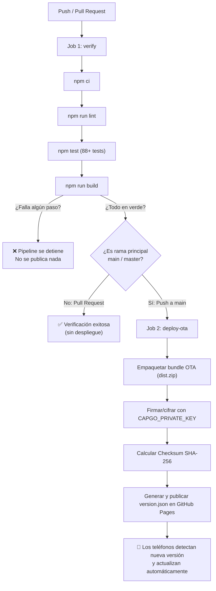

# Finanzas Personales Multimoneda (Venezuela)

Aplicación web progresiva (PWA) y móvil (Capacitor 8 para Android) para el control integral de finanzas personales multimoneda, optimizada con soporte completo para la realidad económica de Venezuela (cálculos en Bolívares BCV/paralelo, Dólares, Euros y Criptomonedas).

---

## 🚀 Características Principales

- **Gestión Multimoneda:** Soporte nativo para VES (Bolívares), USD (Dólares), EUR (Euros), USDT, USDC, BTC y criptomonedas con aritmética de alta precisión mediante `big.js` (evita inconsistencias de redondeo en JavaScript).
- **Tasas de Cambio en Tiempo Real:** Servicio centralizado (`ratesService`) con cotizaciones actualizadas del BCV (USD y EUR vía `dolarvzla` y `ve.dolarapi.com`), Dólar Paralelo, fiat internacionales (`open.er-api.com`) y criptomonedas (Binance).
- **Cuentas y Balances:** Seguimiento de cuentas bancarias nacionales, billeteras digitales, efectivo y plataformas crypto con soporte de transferencias con comisiones y ajustes de saldo auditados.
- **Transacciones y Categorías:** Registro intuitivo de ingresos y gastos con subcategorías, equivalencias históricas en USD basadas en snapshots de tasa y borrado masivo seguro con reversión de balances.
- **Deudas y Cobros (Compromisos):** Seguimiento de deudas por pagar y cuentas por cobrar con vencimientos automáticos (mensual con calendario ajustado, quincenal de 15 y último, semanal o cuota única) y conversión bimoneda en el pago.
- **Presupuestos Mensuales:** Asignación de límites de gasto por categoría sobre el mes calendario actual y visualización de progreso con alertas de exceso.
- **Persistencia Híbrida y Offline-First:** Almacenamiento local ultrarrápido en IndexedDB (mediante Dexie) y sincronización bidireccional con Supabase PostgreSQL basada en borrado lógico (`deleted_at`), cola de cambios offline (`flushQueue`) y resolución por `updated_at` más reciente (`mergeById`).
- **Seguridad Robusta:** Bloqueo biométrico nativo (huella/FaceID) y PIN de 4 a 6 dígitos con hashing SHA-256 local, prevención de respaldos no cifrados en Android (`allowBackup=false`) y verificación obligatoria de firmas/checksums en actualizaciones OTA vía Capgo.

---

## 🛠️ Arquitectura y Tecnologías

- **Frontend:** React 19, Vite, CSS modular responsivo con modo oscuro premium.
- **Móvil / Nativo:** Capacitor 8 con plugins oficiales para Biometría, Estado de App, StatusBar y AutoUpdater.
- **Base de Datos Local:** IndexedDB con Dexie v4 (con migración transparente desde localStorage).
- **Backend / Nube:** Supabase (PostgreSQL con Row Level Security y autenticación segura).
- **Aritmética y Dominio:** `big.js` en capas de dominio desacopladas (`src/domain/money.js`, `src/domain/balances.js`, `src/domain/operations.js`).
- **Testing:** Vitest + React Testing Library con suites unitarias y de integración.
- **CI / CD:** GitHub Actions con verificación rigurosa y publicación OTA en GitHub Pages.

---

## 💻 Configuración Local

### Requisitos
- Node.js 20+
- npm 10+
- (Opcional para Android) Android Studio Jellyfish / Koala con SDK 34+

### Instalación
```bash
git clone https://github.com/pintobg/App-personal.git
cd App-personal
npm install
```

### Variables de Entorno
Copia el archivo de ejemplo y configura tus credenciales de Supabase:
```bash
cp .env.example .env
```
Campos requeridos en `.env`:
```env
VITE_SUPABASE_URL=https://tu-proyecto.supabase.co
VITE_SUPABASE_ANON_KEY=tu-clave-anon-publica
```

---

## 📋 Scripts Disponibles

- `npm run dev`: Inicia el servidor de desarrollo local de Vite en `http://localhost:5173`.
- `npm run build`: Compila la aplicación para producción en la carpeta `dist/`.
- `npm test`: Ejecuta toda la suite de pruebas unitarias y de integración con Vitest.
- `npm run test:watch`: Modo interactivo de pruebas en tiempo real.
- `npm run lint`: Ejecuta el análisis de código estático con Oxlint.
- `npm run cap:sync`: Compila la app y sincroniza los recursos web con el proyecto nativo Android.
- `npm run cap:open`: Abre el proyecto Android nativo en Android Studio.

---

## 🔄 Proceso de Publicación y Actualizaciones OTA (CI/CD)

El flujo de integración continua está definido en [`.github/workflows/ci.yml`](file:///.github/workflows/ci.yml) para proteger la estabilidad de la app y garantizar que ningún cambio con errores llegue a los teléfonos:



### 1. Verificación en cada cambio (Job `verify`)
En cada `push` y cada `pull request` hacia cualquier rama, GitHub Actions ejecuta:
1. `npm ci`: Instalación limpia y determinista de dependencias.
2. `npm run lint`: Validación de código y calidad con Oxlint.
3. `npm test`: Ejecución de todas las pruebas unitarias y de integración con Vitest.
4. `npm run build`: Compilación de la aplicación web con inyección de variables de producción.

Si **cualquier prueba o paso falla**, el pipeline se cancela inmediatamente: **no se genera ningún artefacto ni se publica `version.json`**.

### 2. Publicación de Actualizaciones OTA (Job `deploy-ota`)
Solo cuando todos los pasos del job `verify` pasan en verde y el commit se encuentra en la rama principal (`main` o `master`):
1. Se empaquetan los activos web compilados en `dist.zip`.
2. Se firma y cifra el bundle utilizando la clave privada RSA configurada en GitHub Secrets (`CAPGO_PRIVATE_KEY`).
3. Se calcula el checksum SHA-256 del bundle final.
4. Se genera el manifiesto [`dist/version.json`](https://pintobg.github.io/App-personal/version.json) con los metadatos necesarios:
   - `version`: Hash de commit (`github.sha`).
   - `shortVersion`: Versión corta para el banner informativo en la app.
   - `bundleUrl`: Enlace de descarga directo al paquete `.zip`.
   - `checksum`: Huella SHA-256 obligatoria para verificación de integridad.
   - `sessionKey`: Llave de sesión cifrada con la clave RSA (para desencriptación en el dispositivo).
5. Se publica en **GitHub Pages**. En la próxima apertura de la app (o cada 6 horas), el cliente compara versiones, valida la firma criptográfica y el checksum, y aplica la actualización en caliente sin requerir reinstalación del APK.

---

## 📱 Compilación para Android

1. Sincroniza el build web con el contenedor de Capacitor:
   ```bash
   npm run cap:sync
   ```
2. Abre Android Studio:
   ```bash
   npm run cap:open
   ```
3. En Android Studio, ve a **Build** > **Build Bundle(s) / APK(s)** > **Build APK(s)** para generar el instalador en release o ejecuta directamente en tu teléfono conectado.
